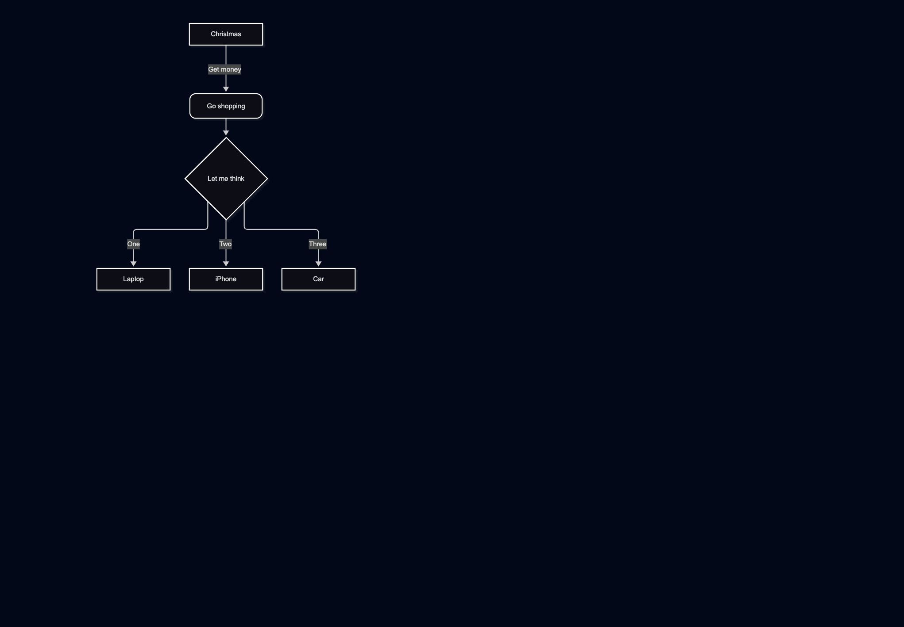
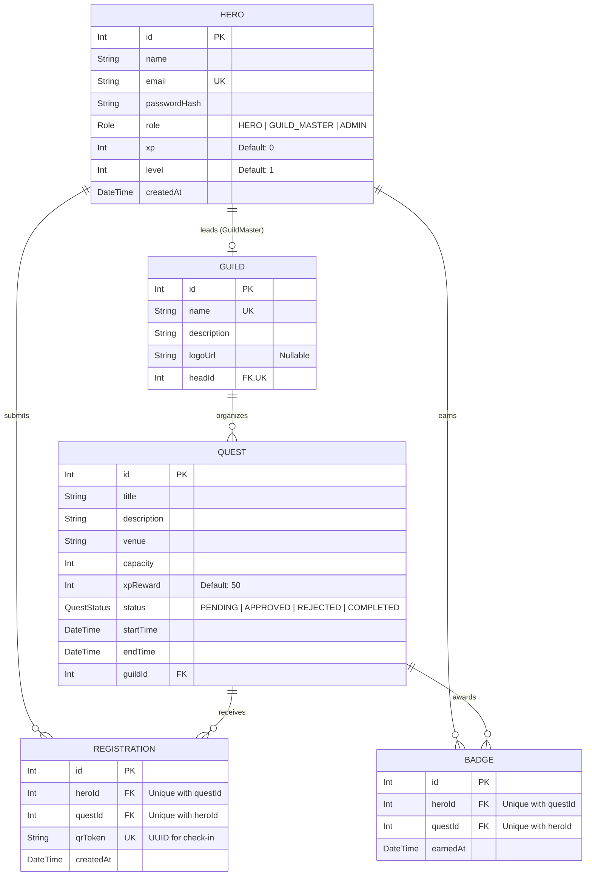

mkdir -p dbms
cat << 'EOF' > dbms/02_er_diagram.md
# Phase 2: Entity-Relationship Diagram (Heroics Platform)

## 1. Visual ER Diagram

## 2. Mermaid ER Diagram

## 3. Entity Relationships Summary

* **Hero to Guild (`1:1`):** One `Hero` (with the `GUILD_MASTER` role) can lead at most one `Guild`, enforced by the `@unique` constraint on `Guild.headId`.
* **Guild to Quest (`1:N`):** One `Guild` can organize and host multiple `Quests` (college events), linked via `Quest.guildId`.
* **Hero to Quest via Registration (`M:N`):** A `Hero` can register for multiple `Quests`, and a `Quest` can have many registered `Heroes`. The `Registration` junction table resolves this relationship, enforces a unique `(heroId, questId)` composite constraint to prevent duplicate sign-ups, and stores a unique `qrToken` for event check-in.
* **Hero to Quest via Badge (`M:N`):** When a `Hero` attends a `Quest`, they earn a `Badge`. The `Badge` junction table tracks attendance rewards and enforces a unique `(heroId, questId)` constraint so a student only earns one badge per event.
EOF
